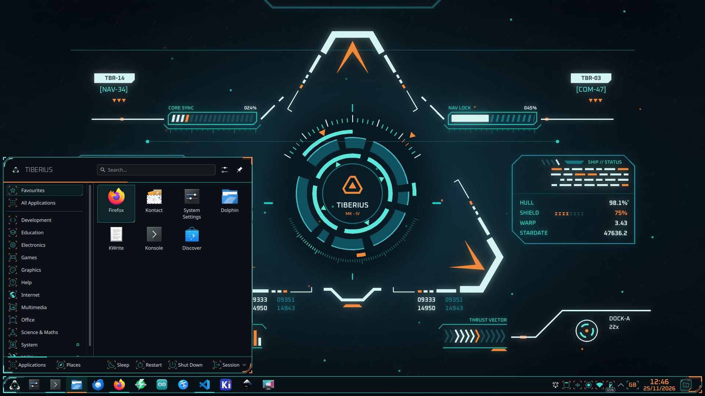
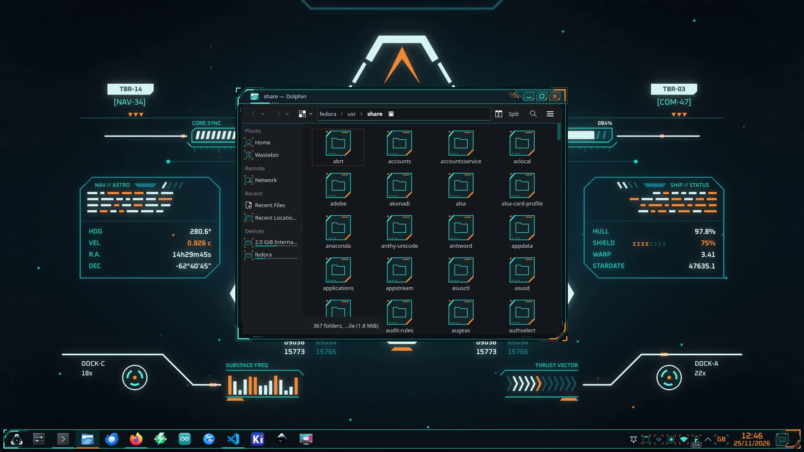
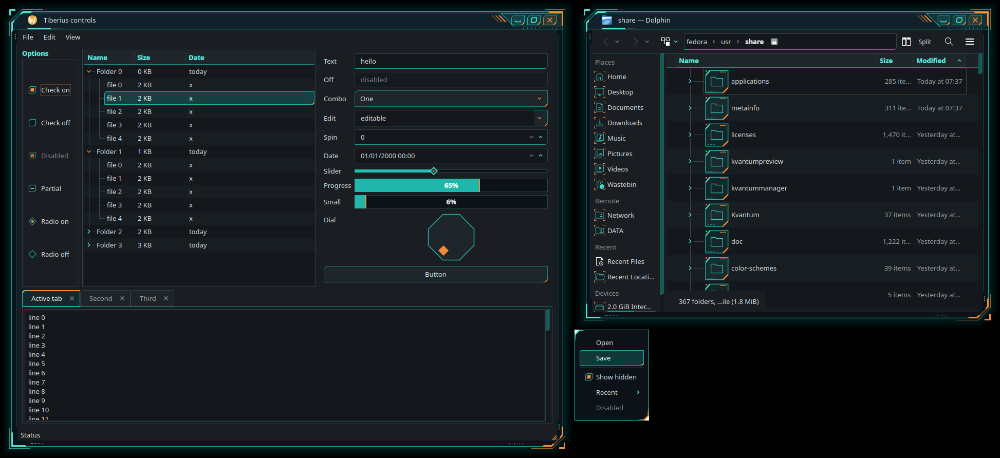

# Tiberius

I've been a Linux user for quite a while and have always been a KDE fan. I wanted my desktop to feel
like the bridge of a starship, and Tiberius is the result: a sci-fi HUD theme for KDE Plasma 6 in teal and orange.

Yet another DAMN Project.

There is a short [video](media/tiberius-desktop.mp4) too, to see the wallpaper moving.

## What you get

- Moving HUD wallpaper, plus a still one
- Window decoration with the cut corners
- Panel, start menu and popups to match
- Kvantum style for buttons, tabs, menus and so on
- Icons for folders, files and the system tray. Apps keep their own icons: I tried replacing them
  and couldn't tell which one was which
- Cursors
- Clock with a calendar, and a keyboard layout indicator

## Installing

You need Plasma 6, Kvantum and Aurorae.

Fedora:

    sudo dnf install kvantum aurorae

Arch:

    sudo pacman -S kvantum aurorae

Debian/Ubuntu:

    sudo apt install qt-style-kvantum

Then download the repo (Code > Download ZIP), unpack it, open a terminal in the folder and run

    bash install.sh

Log out, log back in, done. The clock, menu logo and moving wallpaper take a few extra clicks,
see [INSTRUCTIONS.txt](INSTRUCTIONS.txt).

Don't like it? `bash install.sh --uninstall` puts your old settings back.

## Good to know

- So far it has only been tested on Fedora with Plasma 6.8. If it breaks on yours, open an issue and tell me what happened.
- The panel is made for a horizontal bar, 44 px or taller. Vertical panels aren't done yet.
- If windows look cut off at the bottom right, set the window border size to Very Large.
- Firefox, VSCode and a few others draw their own windows, so they won't change.

The scripts that generate everything are in [source/Tools](source/Tools).

## Licence

GPL 3 or later. The font is Oxanium (OFL 1.1), and the icon glyphs are Material Symbols by Google (Apache 2.0, modified).

Rey Osman
